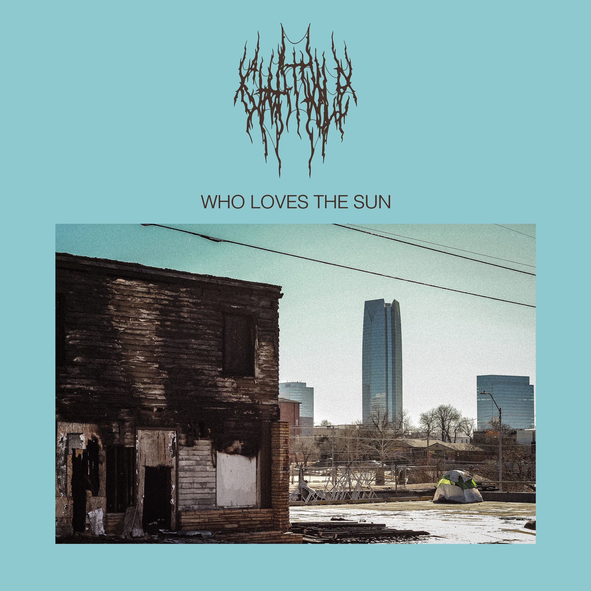

+++
title = "Afinal de contas, quem ama o Sol?"
date = 2026-09-23

[taxonomies]
tags = ["música", "política"]
categories = ["Pessoal"]
+++

Como é estar na interseção entre catástrofe climática, social, política e informacional?

<!--- more --->

Eu mesmo não sei. Só sei que estou ouvindo o excelente _Who Loves the Sun_, do totalmente excelente _Chat Pile_, há algumas semanas. Um disco extremamente pessimista, que literalmente _de cara_ já te expõe um contraste em três perspectivas, o abandonado, o precário e o ultra-moderno:

O próprio nome da banda já é um troço asqueroso, _chat_ aqui não é o gerador de lero lero que vai fazer a sua foto dos anos 80 como se você fosse um personagem de filme do John Landis, mas sim um subproduto da mineração de chumbo e zinco no meio-oeste feita entre os séculos 19 e 20. E sim, é tóxico, muito tóxico, no próprio [verbete da Wikipedia](https://en.wikipedia.org/wiki/Chat_(mining)) referente a esse troço, no capítulo _Usage_ aparecem duas frases iniciadas com _"Although poisonous (...)"_. 

Mas pra além de ser um disco maravilhoso que apropriadamente foi feito por uma banda composta por gente que viveu a vida toda rodeada por essa merda tóxica, é um disco que perpassa várias inquietações atuais. Tecnovigilância, desastre climático em escala global, desconexão... A lista é grande, mas muito bem tratada.

Como adendo, na [página do rateyourmusic](https://rateyourmusic.com/release/album/chat-pile/who-loves-the-sun/) o _genre_ do disco está marcado como _Sludge Metal_ e _Pigfuck_. _Pigfuck_? Eu nunca tinha visto esse termo, mas ele foi [inventado pelo Robert Christgau para classificar o Sonic Youth na mesma prateleira de bandas muito mais inventivas e interessantes como o Big Black](https://crackmagazine.net/article/lists/25-years-of-goo/). Uma doideira, tanto que o próprio Thurston Moore rejeitou o título e escreveu _"I Killed Christgau With My Big Fucking Dick"_. Morde as costas, Julian Casablancas!

Os clipes do Chat Pile pra esse disco, todos na verdade, também são ótimos!

{{ <youtube video_id="kIfoN_Q1TIY" title="Chat Pile - PEN I S MALL"/>}}